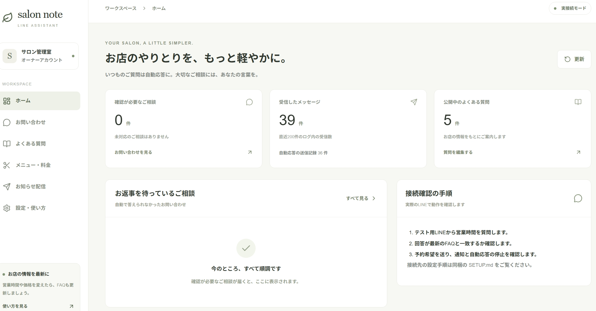
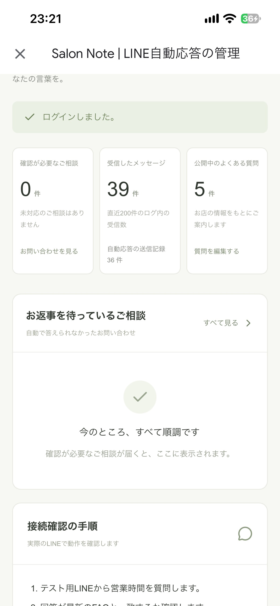

# Salon Note 美容室 LINE自動応答

美容室の公式LINEに届く「よくある質問」に、オーナーが承認した回答だけで自動返信し、答えられない質問はオーナーへ引き継ぐ仕組みです。オーナーはスマホの管理画面でFAQ・料金を更新し、未対応の相談を確認できます。

講座の練習課題として作成しました。**店舗情報はすべて練習用のサンプル**で、実在の店舗やお客様のデータは含みません。

## 公開URL

- 管理画面：https://salon-line-bot-three.vercel.app （Vercel Hobby、練習用の実接続環境。ログインはオーナーのアカウントのみ）
- 利用案内：https://salon-line-bot-three.vercel.app/privacy

本番の環境では、テスト用のLINEユーザー1人だけに応答する設定（`TEST_USER_ONLY=true`）で動かしています。

## できること

- **FAQへの自動回答**：営業時間・料金・予約方法・施術の組み合わせ・駐車場の5分類。Claude APIは「どの承認済みFAQが根拠か」を選ぶだけで、返信の本文はFAQの原文とメニュー表から組み立てます。AIが作った料金や日時は返しません。
- **有人への引き継ぎ**：予約の希望、髪の状態に応じた判断、FAQにない質問は、受付案内を返してオーナーの個人LINEへ通知します。引き継ぎ中は、そのお客様への自動応答を止めます。
- **スマホの管理画面**：FAQ・メニュー・料金の編集、未対応の相談の確認、対応済み・自動応答の再開、未送信の通知の再試行。
- **一斉配信**：LINE公式アカウントの既存の配信画面を使います（このアプリに配信機能は作っていません）。
- **安全のための仕組み**：LINE署名の検証、受信の永続化と重複排除、管理APIの毎回の認可、RLS、AIの回数・予算の上限、30日の保持期限。

## 画面



管理画面のホーム（PCのブラウザ、実接続モード）。確認が必要なご相談・受信したメッセージ・公開中のよくある質問の件数と、お返事を待っているご相談を表示します。



スマホで開いた管理画面のホーム。お返事を待っているご相談を、縦の画面で確認できます。

## 技術

| 区分 | 使用技術 |
|---|---|
| アプリ | Next.js 16（App Router）、TypeScript（strict）、Tailwind CSS、Zod |
| ホスティング | Vercel（Functionsは `syd1`、Cronは1日1回） |
| DB・認証 | Supabase（PostgreSQL、RLS、Auth） |
| AI | Claude API（`claude-sonnet-4-6`） |
| LINE | Messaging API（Webhook、Reply、Push） |
| テスト | Node.jsのテストランナー、PGlite、JSDOM・Testing Library（48件） |

構成図・API・DBは [docs/architecture.md](docs/architecture.md) にまとめています。

## まず画面を試す（デモモード）

Node.js 24をインストールし、このフォルダをVS Codeで開きます。ターミナルで次を実行します。

```sh
npm ci
npm run dev
```

ブラウザで http://localhost:3000 を開きます。環境変数を設定していない場合はデモモードです。実際のLINE送信やClaude APIの呼び出しはありません。

1. ホーム右側で「カットの値段は？」と質問します。
2. 「メニュー・料金」でカットの金額を変えて保存します。
3. ホームに戻って同じ質問をし、新しい料金を確認します。
4. 「明日予約できますか？」と送り、確認待ちに入ることを確認します。
5. 「お問い合わせ」で対応済みにしてから、自動応答を再開します。

デモのFAQ応答はキーワード判定です。本番のAI精度を示すものではありません。変更はブラウザのlocalStorageに保存します。サーバーの実データへは移しません。

## 検証コマンド

```sh
npm test
npm run type-check
npm run build
```

## ドキュメント

| ファイル | 内容 |
|---|---|
| [docs/requirements.md](docs/requirements.md) | 要件定義（仕様の正本） |
| [docs/SETUP.md](docs/SETUP.md) | セットアップ手順（Supabase・LINE・Claude・Vercel） |
| [docs/OWNER_MANUAL.md](docs/OWNER_MANUAL.md) | オーナー向け運用マニュアル |
| [docs/architecture.md](docs/architecture.md) | 技術ドキュメント（連携図・API・DB・費用試算） |
| [docs/TEST_REPORT.md](docs/TEST_REPORT.md) | 確認済みの内容と、未確認・未達の項目 |
| [docs/DELIVERY_CHECKLIST.md](docs/DELIVERY_CHECKLIST.md) | 納品チェックリスト |
| [docs/PROGRESS.md](docs/PROGRESS.md) | 進捗報告 |
| [docs/RETROSPECTIVE.md](docs/RETROSPECTIVE.md) | 振り返り（技術・PM・Claude Code活用・WBS） |
| [CLAUDE.md](CLAUDE.md) | Claude Codeへの作業ルール |

## 主なソース

- `src/app/api/line/webhook/route.ts`：LINE受信
- `src/lib/worker.ts`：回答・送信・有人引き継ぎ・定期処理
- `src/lib/ai.ts`：Claude API・利用上限
- `src/app/api/admin/route.ts`：管理API（毎回の認証・認可）
- `src/components/Dashboard.tsx`：スマホ対応の管理画面
- `supabase/migrations/001_initial.sql`：DB・RLS・排他処理
- `supabase/seed.sql`：練習用の初期データ

## 現在の制約

- 店舗の正式な情報とオーナーの承認がないため、お客様への本番運用はしていません。
- Vercel Hobbyは非商用向けです。店舗の本番運用にはProへの切り替えが必要です。
- 3秒以内の最終返信は保証しません（実測は、DB記録で2〜3秒、体感で約10秒）。
- 未確認の項目は [docs/TEST_REPORT.md](docs/TEST_REPORT.md) の「未確認の項目」を参照してください。
