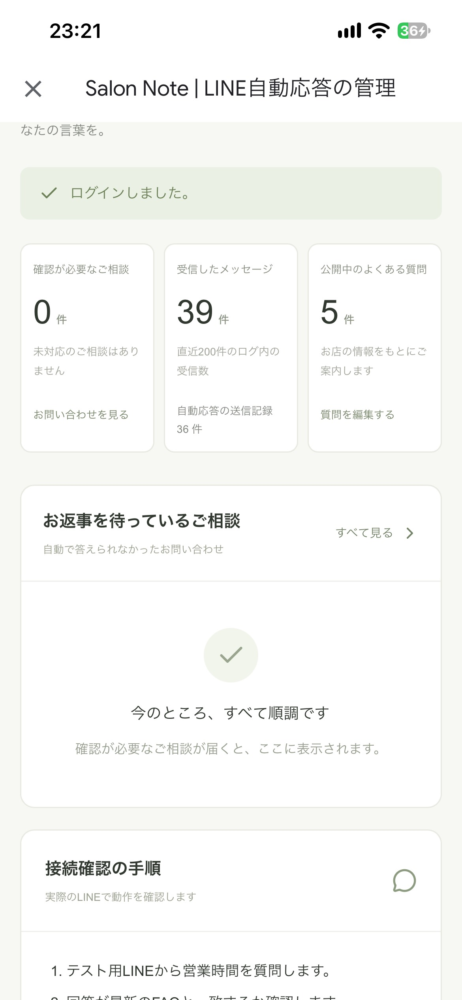
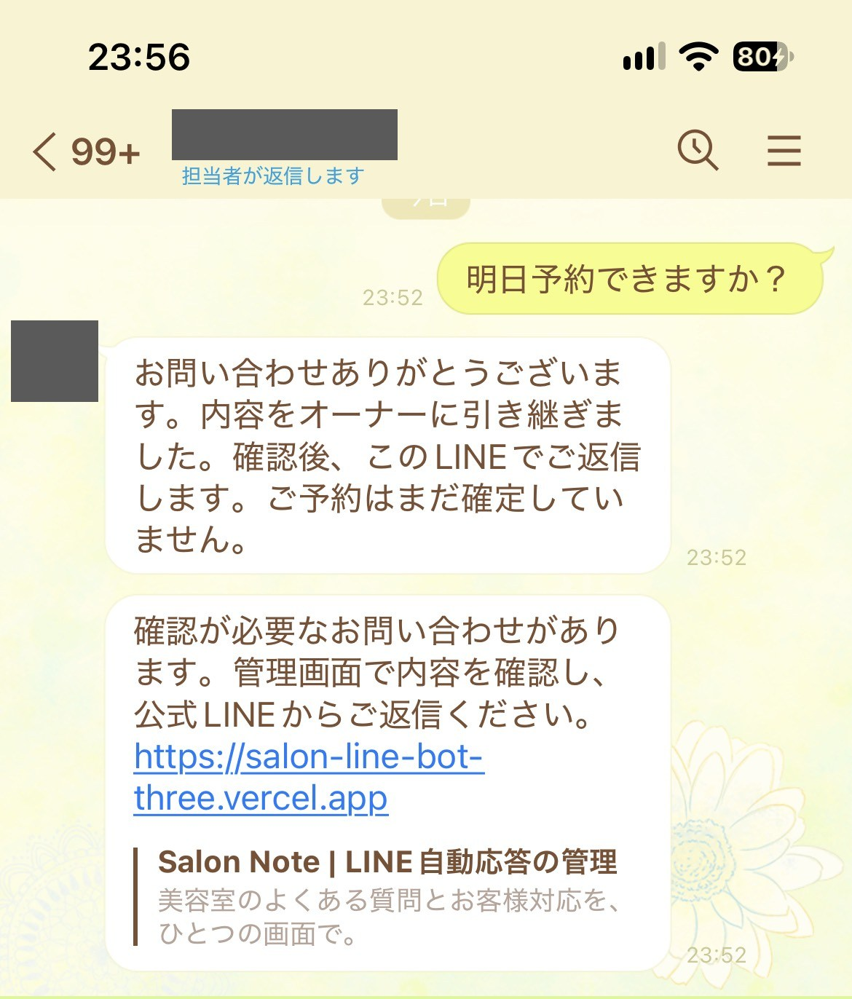
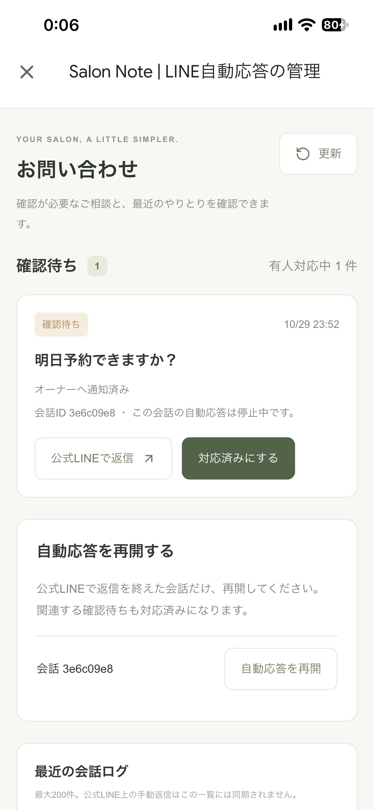
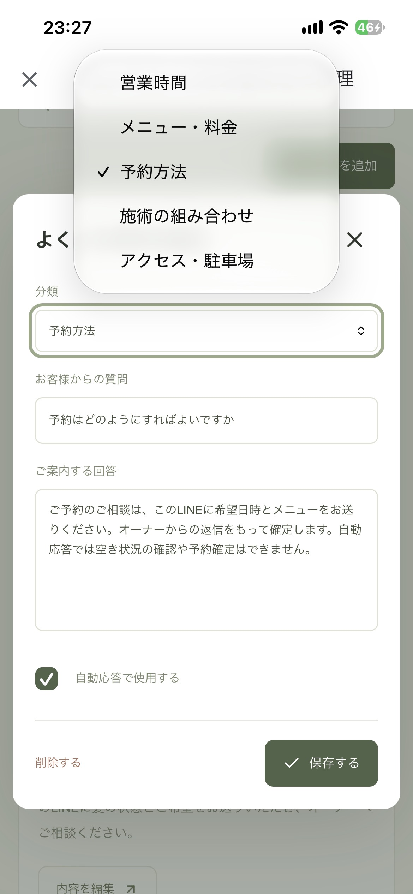
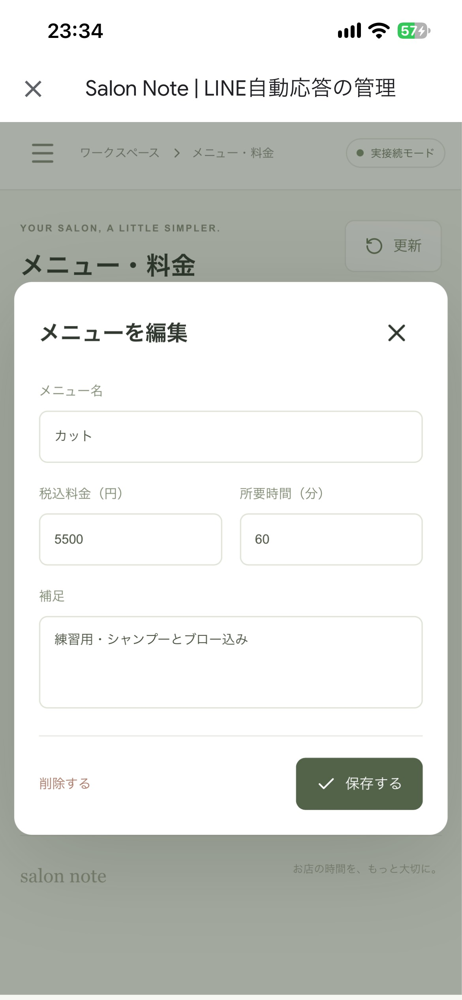
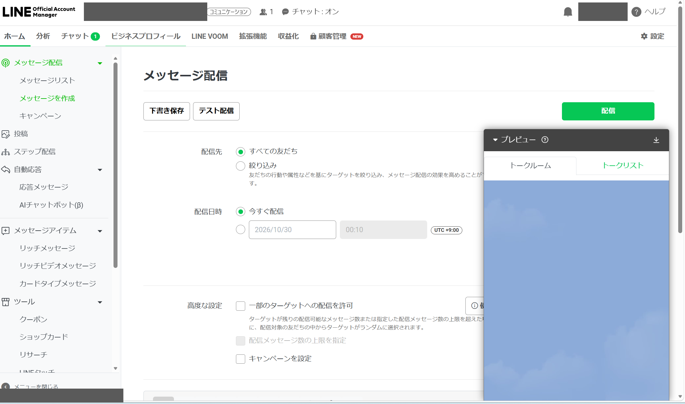

# オーナー向け運用マニュアル

スマホで読めるように、1つの操作を短い手順にまとめています。管理画面は、スマホのブラウザで開いてください。

- 管理画面：`https://salon-line-bot-three.vercel.app`（練習用の環境）
- ログイン：お店の管理アカウント（メールアドレスとパスワード）

> ⚠️ 現在のFAQ・料金・営業時間は、すべて**練習用のサンプル**です。お店の正式な情報に置き換えて承認をいただくまで、お客様への本番運用はしません。

## もくじ

1. [毎日の確認（朝と夕方）](#1-毎日の確認朝と夕方)
2. [お客様への返信と、自動応答の再開](#2-お客様への返信と自動応答の再開)
3. [よくある質問（FAQ）を変える](#3-よくある質問faqを変える)
4. [メニューと料金を変える](#4-メニューと料金を変える)
5. [月2回のお知らせ配信](#5-月2回のお知らせ配信)
6. [自動応答がまちがえたとき](#6-自動応答がまちがえたとき)
7. [困ったとき](#7-困ったとき)
8. [個人情報とバックアップ](#8-個人情報とバックアップ)
9. [問い合わせ窓口](#9-問い合わせ窓口)

## 1. 毎日の確認（朝と夕方）

1. 管理画面を開き、ログインします。
2. ホームの「**お返事を待っているご相談**」を確認します。
3. 「**返信を確認してください**」が出ていたら、[7. 困ったとき](#7-困ったとき)を見てください。

- 通知が来ていなくても、未対応のご相談が残っていることがあります。通知だけに頼らず、管理画面と公式LINEのチャットも確認してください。

## 2. お客様への返信と、自動応答の再開

自動で答えられない質問（予約の希望、髪の状態の相談、FAQにない質問など）が届くと、次のようになります。

- お客様には「オーナーに引き継ぎました」という受付案内が、自動で届きます。
- オーナーの個人LINEに通知が届きます（質問の本文は通知に載りません）。
- そのお客様への**自動応答は止まります**（オーナーが管理画面で「自動応答を再開」を押すまで、自動では答えません）。

上から、お客様の質問、自動で返る受付案内、オーナーへの通知です（この画面は、テスト用にお客様とオーナーを同じLINEで兼ねています）。通知には、お客様の質問の本文は載りません。リンクから管理画面を開いて確認します。

### 返信の手順

1. 管理画面の「**お問い合わせ**」を開き、質問と日時を確認します。
2. 「**公式LINEで返信**」から公式LINEの管理画面を開きます。
   - このボタンでは、該当のお客様のチャットへ直接は移動しません。同じ質問・時間のチャットを探してください。
3. 公式LINEのチャットで、お客様に返信します。
   - 予約は、オーナーが手動で確認・確定します。自動応答は予約を確定しません。
4. 管理画面に戻り、「**対応済みにする**」を押します。
   - これは確認待ちを減らす操作です。自動応答は、まだ止まったままです。
5. お客様とのやり取りが終わったら、「自動応答を再開する」の欄で、その会話の「**自動応答を再開**」を押します。関連する確認待ちも、対応済みになります。

- 管理画面の会話IDは内部の番号で、公式LINEの表示名とは違います。
- 公式LINEで手動返信した文章は、管理画面の会話ログには入りません。

## 3. よくある質問（FAQ）を変える

1. 管理画面の「**よくある質問**」を開きます。
2. 変えたい質問の「**内容を編集**」を押します。「よくある質問を編集」の画面が開くので、「ご案内する回答」の文章を直します。
3. 「**保存する**」を押し、「保存しました。新しいお問い合わせから反映されます。」と表示されたことを確認します。
4. テスト用のLINEから同じ質問を送り、新しい文章が返ることを確認します。

- 自動応答は、ここに保存された**回答の文章をそのまま**お客様に返します。AIが文章を作り変えることはありません。
- 「**自動応答で使用する**」を外すと、そのFAQは使われなくなります。その内容の質問は、オーナーへの引き継ぎになります。
- FAQは最大20件です。
- 営業時間・休業・駐車場などが変わったら、必ず更新してください。
- 料金の数字はFAQの本文に書かず、「メニュー・料金」に登録してください（古い数字が残るのを防ぐため）。

## 4. メニューと料金を変える

1. 管理画面の「**メニュー・料金**」を開きます。
2. 変えたいメニューの「**編集**」を押します。「メニューを編集」の画面が開くので、メニュー名・税込料金（円）・所要時間（分）・補足を直します。
3. 「**保存する**」を押し、保存できたことの表示を確認します。
4. テスト用のLINEから「カットはいくらですか？」のように料金を質問し、新しい料金が返ることを確認します。

- メニューは最大30件です。
- 料金の質問には、料金のFAQとこのメニュー表を組み合わせて返信します。

## 5. 月2回のお知らせ配信

お知らせは、**LINE公式アカウントの管理画面**から送ります。この管理画面には、一斉送信のボタンはありません。

左上の「**テスト配信**」は権限メンバーだけに届きます。右上の緑の「**配信**」は友だち全員に届くので、確認が終わるまで押しません。

1. 管理画面の「**お知らせ配信**」から、LINE公式アカウントの管理画面へ進みます。
2. 「メッセージ配信」→「メッセージを作成」で、お知らせの文章を作ります。
3. 「**テスト配信**」を押します。
   - テスト配信は、公式アカウントの**権限を持つメンバーにだけ**届きます。お客様には届きません。
   - 事前に「設定」→「権限管理」で、メンバーが誰かを確認しておきます。
4. 自分のLINEに届いた文章を確認します。
5. 宛先・配信日時・残りの配信通数を確認してから、「配信」を押します。

- 300人へ月2回送ると、約600通です。オーナーへの通知も通数を使います。配信の前に、残りの通数を確認してください。
- 配信できる人数は、友だちの数と違う場合があります。

## 6. 自動応答がまちがえたとき

自動応答が、まちがった案内や古い情報を返したときの手順です。

1. **お客様に訂正する**
   - 公式LINEのチャットで、正しい内容をお客様に送ります。
2. **原因を確かめる**
   - 管理画面の「最近の会話ログ」で、お客様の質問と自動応答の返信を確認します。
   - 返信が、FAQやメニューの文章そのままかを見ます。
3. **情報を直す**
   - FAQやメニューの文章が古い・まちがっている場合は、[3](#3-よくある質問faqを変える)・[4](#4-メニューと料金を変える)の手順で直して保存し、テスト用のLINEで確認します。
   - 文章は正しいのに、ちがう質問に使われた場合は、そのFAQの「**自動応答で使用する**」を外します。その内容の質問は、オーナーへの引き継ぎになります。
4. **窓口に知らせる**
   - [9. 問い合わせ窓口](#9-問い合わせ窓口)へ、次の3点を知らせてください。
     - 起きた日時
     - お客様の質問の要約
     - 返った回答の要約
   - お客様のお名前やLINEの画面をそのまま送る必要はありません。

自動応答をすべて止めたいときは、窓口へ連絡してください。窓口の担当者が、LINEの接続を止めます。

## 7. 困ったとき

| 困ったこと | まず確認すること |
|---|---|
| 通知が来ない | 管理画面の未対応一覧を見てください。「設定・使い方」の「**未送信通知を再試行**」で、送れなかった通知を送り直せます。続く場合は、友だち追加・通知先・配信通数について窓口に確認してください |
| 自動応答しない | そのお客様が有人対応中になっていないか確認します。AIの利用上限に達した場合も、有人対応になります |
| 返信が二重に届く | 公式LINE側の自動応答（応答メッセージ）がオンになっていないか、窓口に確認してください |
| 「返信を確認してください」が出た | 自動応答の返信が届いたかどうか、わからない状態です。公式LINEで実際の送信履歴を確認してから、必要なら手動で返信してください（自動では再送しません） |
| 変更が反映されない | 保存の表示を確認し、画面を更新します。必要ならログインし直して、新しい質問で確認します |
| ログインできない | パスワードを他の人と共有せず、窓口に連絡してください |

## 8. 個人情報とバックアップ

- 氏名・電話番号・健康情報など、回答に必要のない情報は集めません。
- 自動応答はAI（Claude API）を使うため、お客様向けの利用案内（`/privacy`）を提示してください。
- 会話は、30日を超えたものを1日1回の定期処理で削除します。通常は31日程度残る場合があり、定期処理が失敗した日はさらに残ることがあります。
- 削除の依頼を受けたときは、窓口へ連絡してください。本人確認のあと、対象のログを削除します。
- FAQ・料金を変えたら、「設定・使い方」の「**FAQ・メニューを書き出す**」でJSONを保存してください（会話の文章は書き出しません）。
- パスワードや秘密のキーを、他の人と共有しないでください。

## 9. 問い合わせ窓口

| 項目 | 内容 |
|---|---|
| 窓口 | （未記入：確認中） |
| 連絡方法 | （未記入：確認中） |
| 対応する時間 | （未記入：確認中） |
| 対応する範囲 | 設定・不具合・自動応答の停止・削除の依頼 |

納品後14日間は、合意した範囲内の不具合を修正します（練習用の条件）。継続の保守は別の契約です。
