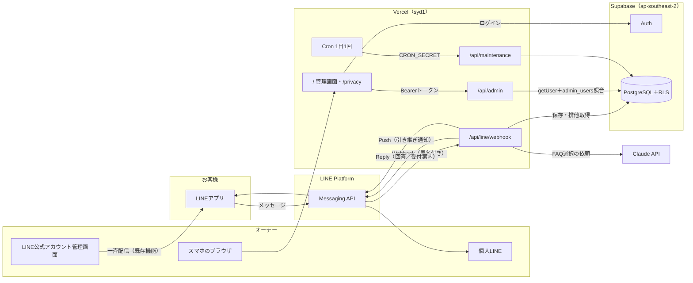
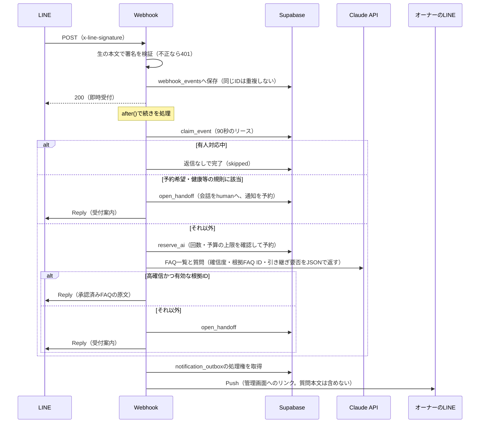

# 技術ドキュメント（システム設計と費用試算）

2026-10-29更新。API・DB・外部連携は `src/` と `supabase/migrations/001_initial.sql` の実装に合わせて記載している。費用試算は2026-10-21確認の商用運用案。

## 外部サービス連携図

- 一斉配信は、LINE公式アカウントの既存の配信画面から行う。このアプリには配信機能がない。
- 料金・営業時間などの正式な情報は、DB（`faqs`・`menus`）が正本。AIはFAQのIDを選ぶだけで、返信の本文は承認済みFAQの原文とメニュー表から組み立てる。

## メッセージ処理の流れ

- 送信開始後に結果が不明になったReplyは再送しない（`reply_status = unknown`）。管理画面に「返信を確認してください」と表示する。
- 引き継ぎ通知のPushは、同じretry key（`X-Line-Retry-Key`）で最大5回まで再試行する。
- 処理中に止まった受信は、次の受信時（最大3件）か、定期処理で拾い直す。Reply tokenの期限（受信から55秒で判定）を過ぎていれば、AIを呼ばずに引き継ぐ。

## API

| メソッド・パス | 呼び出し元 | 認証・検証 | 内容 |
|---|---|---|---|
| `POST /api/line/webhook` | LINE Platform | `x-line-signature` を生の本文とChannel secretで検証。本文は256KBまで、イベントは100件までをZodで検証 | 受信の保存、即時200、`after()` で返信・引き継ぎ・通知。デモモードでは503 |
| `GET /api/admin` | 管理画面 | `Authorization: Bearer <Supabaseのアクセストークン>`。毎回 `auth.getUser` と `admin_users` を照合（未ログイン401、オーナー以外403） | FAQ・メニュー・会話（100件）・メッセージ（200件）・引き継ぎ（100件）・要確認の受信（30件）・今月のAI利用件数 |
| `POST /api/admin` | 管理画面 | 同上。本文は20KBまで、Zodで検証 | `faq_save`（20件まで）・`menu_save`（30件まで）・`faq_delete`・`menu_delete`・`close`（対応済み）・`resume`（自動応答の再開）・`retry_notifications`（通知の再試行） |
| `GET /api/maintenance` | Vercel Cron | `Authorization: Bearer <CRON_SECRET>` を時間一定の比較で検証 | 止まった受信の拾い直し（10件まで）、AI利用上限の接近通知、通知の再送、保持期限の削除 |
| `GET /` | ブラウザ | 画面の表示は誰でも可。データはログイン後に管理APIから取得 | 管理画面（デモモードではブラウザ内のサンプル） |
| `GET /privacy` | ブラウザ | なし | お客様向けの利用案内 |

## DB

`supabase/migrations/001_initial.sql` で作成する。全テーブルでRLSを有効にしている。

| テーブル | 主な列 | 用途 |
|---|---|---|
| `admin_users` | `user_id`（auth.usersを参照） | オーナーの登録。ここにいる利用者だけが管理APIとRLSで許可される |
| `faqs` | `id`, `category`（hours/price/booking/combination/parking）, `question`, `answer`, `enabled`, `updated_at` | 承認済みFAQ。`answer` が返信の原文 |
| `menus` | `id`, `name`, `price_yen`, `duration_minutes`, `notes`, `updated_at` | メニューと税込料金。料金の正本 |
| `conversations` | `id`, `line_user_id`（一意）, `mode`（bot/human）, `updated_at` | お客様ごとの自動応答／有人対応の状態 |
| `webhook_events` | `id`（webhookEventId）, `payload`, `state`, `reply_status`, `lease_until`, `created_at` | 受信の永続化、重複排除、処理の排他 |
| `messages` | `conversation_id`, `event_id`, `direction`（in/out）, `text`, `created_at` | 会話ログ（受信1件につき入出各1件まで） |
| `handoffs` | `event_id`（一意）, `conversation_id`, `question`, `status`（open/closed）, `notification_status`, `created_at` | 有人引き継ぎ |
| `notification_outbox` | `dedupe_key`（一意）, `handoff_id`, `kind`（handoff/usage）, `status`, `attempts`, `next_attempt_at` | 通知の送信待ち行列と再試行 |
| `ai_requests` | `line_user_id`, `cost_usd`, `input_tokens`, `output_tokens`, `created_at` | AI呼び出しの費用予約と精算、上限管理 |

### 権限（RLS）

- ログイン済みのオーナー（`is_owner()`）は、全テーブルを読み取れる。書き込めるのは `faqs`・`menus` だけ。
- 引き継ぎ・会話の状態・通知・利用記録への書き込みは、サーバーの `service_role` だけが行う。オーナーが画面から行う操作も、管理APIで認可したうえでサーバーが実行する。
- 匿名（anon）には、テーブルも関数も許可していない。

### DB関数（service_roleのみ実行可）

| 関数 | 内容 |
|---|---|
| `claim_event(event_key)` | 未返信の受信に90秒のリースを付けて処理権を取得 |
| `reserve_ai(uid, reserve_usd, month_limit, day_limit, budget_usd)` | 月間回数・ユーザー別の日次回数・月間予算をロックの中で確認し、費用を先に予約 |
| `open_handoff(event_key, conversation_key, question_text)` | 会話を `human` にし、引き継ぎと通知を受信1件につき1回だけ作成 |
| `resume_conversation(conversation_key)` | 未対応の引き継ぎを閉じ、会話を `bot` に戻す |
| `retain_recent_data()` | 30日を超えた受信・会話・通知を削除し、AI利用記録を匿名化する |

## 外部サービスと環境変数

| サービス | 使う機能 | 環境変数 |
|---|---|---|
| LINE Messaging API | Webhook受信、Reply、Push | `LINE_CHANNEL_SECRET`, `LINE_CHANNEL_ACCESS_TOKEN`, `LINE_OWNER_USER_ID`, `TEST_LINE_USER_ID` |
| Supabase | Auth（オーナーのログイン）、PostgreSQL | `NEXT_PUBLIC_SUPABASE_URL`, `NEXT_PUBLIC_SUPABASE_ANON_KEY`（公開可）, `SUPABASE_SERVICE_ROLE_KEY`（サーバー専用） |
| Claude API | Messages API（`claude-sonnet-4-6`） | `ANTHROPIC_API_KEY`, `ANTHROPIC_MODEL`, `AI_MONTHLY_LIMIT`, `AI_USER_DAILY_LIMIT`, `AI_MONTHLY_BUDGET_USD` |
| Vercel | ホスティング、Functions（syd1）、Cron | `APP_URL`, `CRON_SECRET` |
| アプリの動作 | デモ／実接続、Echo／FAQ、本人限定 | `NEXT_PUBLIC_DEMO_MODE`, `BOT_MODE`, `TEST_USER_ONLY` |

秘密値は環境変数だけで管理し、`NEXT_PUBLIC_` には公開してよい値だけを置く。ログには、トークンやお客様の質問を出さない。

## 技術選定

| 項目     | 採用案                    | 条件                                                            |
| -------- | ------------------------- | --------------------------------------------------------------- |
| アプリ   | Next.js 16（App Router）とTypeScript strict、Tailwind CSS | 管理画面とAPIを同じプロジェクトで管理。外部入力はZodで検証 |
| サーバー | Vercel Pro                | 商用利用。Hobbyを店舗本番には使わない。練習課題の公開はHobby（Cron 1日1回）で行う |
| DBと認証 | Supabase Free             | 小規模の試験運用。1週間非稼働で休止等の制約に合意。有料化は別途 |
| AI       | Claude Sonnet 4.6を仮採用 | 実装開始時に提供状況を再確認。FAQで品質と実コストを測定         |
| 配信     | 公式LINE既存機能          | 独自画面を省いて開発費を抑制                                    |

## 練習用の運用条件

月額上限は利用料合計で税込12,000円。一斉配信は公式LINE既存画面から月2回、各約300人。導入希望日は2026年11月6日。いずれも実際の回答ではなく練習用の仮定。

## 月額試算

為替は試算用に1ドル150円と仮定。現在の為替レートの主張ではない。外貨サービスの税・決済差額・超過料金は別。保守費と独自ドメイン代は含まない。

| 項目          | 試算                          | 根拠                                                                                                                                           |
| ------------- | ----------------------------- | ---------------------------------------------------------------------------------------------------------------------------------------------- |
| LINEライト    | 5,500円税込                   | 月5,000通まで。300人へ月2回配信なら約600通。別途オーナー通知も通数に加算                                                                       |
| Vercel Pro    | 20ドル 約3,000円 税別相当     | 1デプロイ席を含む。超過・追加席は別                                                                                                            |
| Supabase Free | 0円                           | 無料枠・休止等の条件内                                                                                                                         |
| Claude        | 5.25ドル 約788円 税別相当     | 月500回 ×（入力2,000×3ドル/100万＋出力300×15ドル/100万）                                                                                       |
| 合計          | 約9,300円＋外貨サービスの税等 | 月額5,000円以下には収まらない。外貨サービス分に仮に税相当10％を加えると約9,700円となり、仮の上限12,000円内。実請求・為替・使用量により変動する |

AIが月1万回なら同条件で105ドル、約15,750円。講座の「1万件でも数百円」をそのまま使わない。会話の往復・長い履歴・再試行で費用は増える。FAQの定型回答併用でAI利用を減らせるが、初回試算では全500回のAI呼び出しを想定した。

実測（2026年10月28日、本番の練習環境）では、AI呼び出し1回あたり入力約1,390トークン・出力約40トークン、約0.0045〜0.0049ドルだった。試算の1回あたり約0.0105ドルより小さい。

無料LINEの月200通では、配信可能対象が300人いる場合の全員配信1回を賄えない。友だち数と実際の配信対象人数は一致しない場合があるため管理画面で確認する。Reply APIの応答は配信通数の対象外、Push通知・一斉配信は対象。無料枠を使う案は全員配信を保留する等、要件を変えた別案として承認を得る。月額上限が5,000円なら、そのまま契約せず構成・配信要件を見直す。

## 公式確認先

- LINE料金 https://www.lycbiz.com/jp/service/line-official-account/plan/
- LINE通数 https://developers.line.biz/ja/docs/messaging-api/pricing/
- Vercel Hobby制限 https://vercel.com/docs/plans/hobby
- Vercel Pro https://vercel.com/docs/plans/pro-plan
- Supabase https://supabase.com/pricing
- Claude単価 https://platform.claude.com/docs/en/about-claude/pricing
